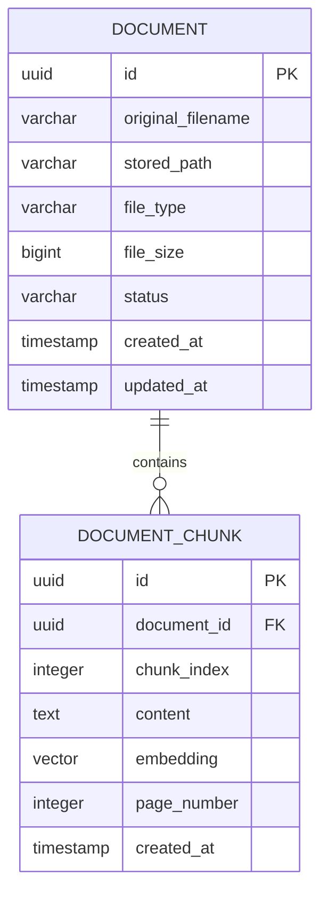

# Local Knowledge AI — Database Basic Design

| 항목 | 내용 |
|---|---|
| Project | Local Knowledge AI |
| Document | 데이터베이스 기본설계서 (データベース基本設計書) |
| Version | 0.1 |
| Date | 2026-10-20 |
| Phase | Phase 1 — Basic Design |
| Status | DRAFT |
| Related Documents | `architecture.md`, `data-flow.md`, `screen-design.md` |
| Requirements | FR-001 ~ FR-009, NFR-002, NFR-005, NFR-006 |

---

## 1. 설계 목적

본 문서는 Local Knowledge AI의 문서 저장 및 검색에 필요한 논리 데이터 모델과 데이터베이스 기본 구조를 정의한다.

설계 목표:

1. 원본 문서 및 메타데이터 관리
2. 텍스트 Chunk 및 Embedding 저장
3. Document와 DocumentChunk의 관계 정의
4. 문서 처리 상태 관리
5. Vector Search 지원
6. 비동기 문서 처리와 데이터 정합성 확보
7. 향후 기능 확장 고려

실제 SQL DDL, JPA Entity 및 Flyway Migration 구현은 후속 단계에서 진행한다.

## 2. 데이터베이스 기술 구성

| Technology | Purpose | Status |
|---|---|---|
| PostgreSQL | 관계형 데이터 저장 | 잠정 선정 |
| pgvector | 벡터 저장 및 검색 | 잠정 선정 |
| Spring Data JPA | 엔티티 및 일반 데이터 접근 | 연동 방식 검토 |
| Spring AI | Embedding 및 Vector Store 연동 | 검토 |
| Flyway | DB 스키마 버전 관리 | 잠정 선정 |

MVP에서는 별도의 Vector Database 서버를 도입하지 않는다.

### Vector Storage Integration Decision

Decision: ADR-001 ACCEPTED

벡터 저장 및 검색은 자체 PostgreSQL + pgvector SQL Adapter를 사용한다.

- Spring AI는 Ollama LLM 및 Embedding 호출을 담당한다.
- Document 메타데이터 관리는 Spring Data JPA를 우선 사용한다.
- DocumentChunk 벡터 저장 및 검색은 JDBC 기반 SQL Adapter를 사용한다.
- 프로젝트 전용 `document` 및 `document_chunk` 테이블을 유지한다.
- Flyway로 스키마 변경을 관리한다.
- Spring AI PgVectorStore는 MVP의 기본 벡터 저장 구현으로 사용하지 않는다.

Embedding 차원, JDBC 타입 매핑, 인덱스 및 검색 성능은 Phase 2에서 검증한다.

초기 설계는 프로젝트 전용 데이터 모델을 기준으로 한다.

## 3. 논리 데이터 모델

### 3.1 MVP 테이블

| Table | Description | Priority |
|---|---|---|
| document | 원본 문서 메타데이터 및 처리 상태 | P0 |
| document_chunk | 분할 텍스트, 임베딩, 출처 위치 | P0 |

### 3.2 향후 확장 테이블

| Table | Description | Priority |
|---|---|---|
| chat_session | 대화 세션 | P1 |
| chat_message | 사용자 및 AI 메시지 | P1 |
| message_source | 저장된 답변과 근거 Chunk의 관계 | P1 |

P1 테이블은 현재 생성하지 않는다.

P0에서는 답변과 출처를 API 응답으로 반환하되 채팅 기록은 영구 저장하지 않는다.

## 4. ERD — 논리 관계

관계:

- DOCUMENT 1 : N DOCUMENT_CHUNK
- DOCUMENT_CHUNK는 하나의 DOCUMENT에 속한다.
- DOCUMENT는 0개 이상의 Chunk를 가질 수 있다.
- Chunk는 독립적으로 존재할 수 없다.

## 5. DOCUMENT 테이블

### 5.1 목적

업로드된 원본 파일의 메타데이터와 처리 상태를 관리한다.

### 5.2 컬럼 설계 초안

| Column | Type | Nullable | Description |
|---|---|---|---|
| id | UUID | NO | 문서 고유 식별자 (PK) |
| original_filename | VARCHAR(255) | NO | 사용자 원본 파일명 |
| stored_path | TEXT | NO | 로컬 저장 위치 |
| file_type | VARCHAR(10) | NO | PDF 또는 TXT |
| file_size | BIGINT | NO | 파일 크기(Byte) |
| status | VARCHAR(20) | NO | 문서 처리 상태 |
| created_at | TIMESTAMPTZ | NO | 생성 시각 |
| updated_at | TIMESTAMPTZ | NO | 수정 시각 |

### 5.3 PK 정책

UUID를 우선 제안한다.

선정 근거:

- 다른 환경으로 데이터 이전 시 ID 충돌 가능성 감소
- 외부 API에서 단순 증가형 ID 노출 회피
- 향후 다중 사용자 확장 고려

UUID 생성 주체는 애플리케이션과 DB 중 하나로 결정한다.

### 5.4 처리 상태

| Status | Description |
|---|---|
| UPLOADED | 업로드 완료 및 처리 대기 |
| PROCESSING | 문서 추출·분할·임베딩 중 |
| COMPLETED | 검색 가능한 상태 |
| FAILED | 처리 실패 |

상태는 애플리케이션 Java Enum과 문자열 컬럼의 조합을 우선 제안한다.

PostgreSQL 전용 Enum 사용 여부는 후속 검토 대상으로 한다.

### 5.5 검증 규칙

- original_filename: 필수
- stored_path: 필수
- file_type: PDF/TXT만 허용
- file_size: 0보다 커야 함
- status: 허용된 상태 값만 사용
- created_at / updated_at: 필수

파일 중복 등록 및 동일 해시 기반 중복 검사 정책은 미결정이다.

## 6. DOCUMENT_CHUNK 테이블

### 6.1 목적

원본 문서에서 분할한 텍스트 및 검색용 임베딩 벡터를 관리한다.

### 6.2 컬럼 설계 초안

| Column | Type | Nullable | Description |
|---|---|---|---|
| id | UUID | NO | Chunk ID (PK) |
| document_id | UUID | NO | DOCUMENT 참조 (FK) |
| chunk_index | INTEGER | NO | 문서 내 Chunk 순서 |
| content | TEXT | NO | 분할된 문서 텍스트 |
| embedding | VECTOR(D) | NO | Embedding 벡터 |
| page_number | INTEGER | YES | PDF 원본 페이지 |
| created_at | TIMESTAMPTZ | NO | 생성 시각 |

D는 Embedding 모델의 출력 차원이다.

실제 차원 수와 `VECTOR(D)` 선언은 모델 검증 후 확정한다.

텍스트의 정확한 시작·끝 위치 및 페이지 경계를 넘는 Chunk의 출처 관리 방식은 추가 검토한다.

### 6.3 관계 및 제약조건

- document_id는 DOCUMENT.id를 참조한다.
- document_id는 NULL일 수 없다.
- chunk_index는 0 이상의 정수로 제안한다.
- 동일 문서에서 chunk_index가 중복되지 않도록 제약한다.
- content는 빈 문자열이 될 수 없도록 검증한다.

후보 제약조건:

`UNIQUE(document_id, chunk_index)`

재처리 과정에서 Chunk Index 충돌이 발생하지 않도록 저장 정책을 정의해야 한다.

### 6.4 Embedding 정책

Embedding 모델 후보:

`qwen3-embedding:0.6b`

Embedding 모델을 최종 선정한 후 벡터 차원을 확정한다.

문서 Chunk와 질문은 호환 가능한 같은 임베딩 공간에서 생성한다.

모델을 변경하면 기존 벡터의 재생성이 필요할 수 있다.

모델명과 버전 추적 방식은 추가 설계 대상으로 한다.

## 7. 벡터 검색 설계

### 7.1 검색 대상

검색 대상은 `status = COMPLETED`인 DOCUMENT에 속한 DOCUMENT_CHUNK로 제한한다.

처리 중이거나 실패한 문서의 Chunk는 검색하지 않는다.

### 7.2 검색 방식

pgvector를 사용하여 벡터 유사도 검색을 수행한다.

초기에는 Cosine Distance를 우선 검토한다.

정확 검색(Exact Search)으로 기본 품질을 확인한 뒤, 데이터 양과 응답 속도에 따라 HNSW 인덱스 사용 여부를 판단한다.

### 7.3 인덱스 후보

- DOCUMENT의 status 인덱스
- DOCUMENT_CHUNK의 document_id 인덱스
- UNIQUE(document_id, chunk_index)
- Embedding Vector Search 인덱스

실제 인덱스는 조회 패턴 및 데이터량 확인 후 확정한다.

M1 8GB 환경을 고려하여 불필요한 인덱스 생성을 최소화한다.

## 8. 데이터 정합성 및 트랜잭션

### 8.1 원본 파일과 DB

원본 파일 저장과 DB 메타데이터 등록은 별도의 자원에 해당한다.

다음 상황에 대한 처리 정책이 필요하다.

- 파일 저장 성공 / DB 등록 실패
- DB 등록 성공 / 비동기 작업 시작 실패
- 파일이 사라졌지만 DB 정보가 남아 있는 경우

보상 작업 또는 복구 절차를 상세설계에서 정의한다.

### 8.2 Chunk 및 Embedding 저장

문서 임베딩 처리 중 일부 Chunk만 저장되는 상황을 고려한다.

제안 정책:

1. 처리 시작 전 Document 상태 변경
2. 추출 및 임베딩 처리
3. 완성된 Chunk 데이터 저장
4. DB 트랜잭션을 이용한 정합성 확보
5. 저장 완료 후 Document 상태를 COMPLETED로 변경

LLM 또는 Embedding 모델 호출 중 DB 트랜잭션을 장시간 유지하지 않는 방향으로 설계한다.

Chunk 교체와 완료 상태 변경은 가능한 한 일관된 DB 트랜잭션 내에서 처리하도록 검토한다.

### 8.3 실패 시 상태

처리 실패 시 Document 상태를 FAILED로 기록한다.

불완전한 Chunk를 검색에서 제외한다.

재처리 시 기존 Chunk 정리 또는 교체 방식으로 중복을 방지한다.

## 9. 문서 처리 작업 복구 정책

현재 상태 컬럼만으로 기본 복구 흐름을 구성하는 방안을 검토한다.

서버 시작 시:

1. UPLOADED 상태 문서 확인
2. 이전 실행에서 중단된 PROCESSING 문서 확인
3. 원본 파일 존재 여부 확인
4. 복구 가능한 문서를 재처리 대상으로 지정
5. 중복 작업 실행을 방지한 상태에서 처리 재개

다음 사항은 상세설계에서 결정한다.

- 처리 시작 시각 기록 여부
- 작업 재시도 횟수
- 마지막 오류 코드 및 오류 발생 시각
- 재시작 후 PROCESSING 상태의 복구 조건
- 비동기 작업의 중복 실행 방지
- DB 장애 시 상태 기록 실패 대응

필요하면 DOCUMENT 테이블에 추가 컬럼을 도입한다.

## 10. 문서 삭제 정책

문서 삭제 기능은 P1로 유지한다.

DB 관계상 DOCUMENT 삭제 시 연결된 Chunk를 어떻게 처리할지 설계가 필요하다.

초기 방향:

- 참조 무결성 보장
- 연결된 Chunk의 고아 레코드 방지
- 원본 파일과 DB 데이터 삭제의 정합성 고려

`ON DELETE CASCADE` 또는 애플리케이션 명시적 삭제 방식은 후속 검토한다.

## 11. 시간 및 감사 데이터

시간 컬럼은 TIMESTAMPTZ 사용을 우선 제안한다.

실제 저장·표시 시간대 정책은 애플리케이션에서 일관되게 관리한다.

기본 감사 항목:

- created_at
- updated_at (DOCUMENT)
- created_at (DOCUMENT_CHUNK)

추후 필요 시 처리 시작·완료 시각을 추가한다.

## 12. Spring Boot와 DB 연동

### 12.1 일반 데이터 접근

Document 메타데이터 관리는 Spring Data JPA 사용을 우선 검토한다.

### 12.2 벡터 접근

ADR-001에 따라 자체 pgvector SQL Adapter를 사용한다.

- Chunk와 Embedding 저장: JDBC 기반 SQL 접근
- Vector Similarity Search: pgvector SQL
- 검색 대상: COMPLETED 상태의 Document
- 초기 검색 방식: Exact Search 우선 검증
- 거리 계산: Cosine Distance 우선 검토
- 검색 결과: Document ID, Chunk ID, Content, Source Location, Distance/Score

Spring AI는 모델 호출에 사용하며 DB VectorStore 기능은 기본 저장 구현으로 사용하지 않는다.

Embedding Model은 `qwen3-embedding:0.6b`를 우선 검증한다.

벡터 차원은 1024를 검증 후보로 삼으며, Ollama에서 실제 출력 차원을 확인한 후 확정한다.

해당 결정은 ADR-001을 기준으로 관리한다.

## 13. Flyway Migration 정책

Flyway로 DB 스키마 변경 이력을 관리하는 방향을 유지한다.

예상 Migration:

- pgvector 확장 활성화
- DOCUMENT 테이블 생성
- DOCUMENT_CHUNK 테이블 생성
- PK / FK / UNIQUE / CHECK 제약조건 설정
- 기본 인덱스 생성

실제 파일명, DDL 및 실행 순서는 개발 환경 구축 이후 확정한다.

## 14. 미결정 사항

| ID | Item | Decision Needed |
|---|---|---|
| DB-001 | UUID 생성 방식 | 애플리케이션 또는 DB |
| DB-002 | Embedding 차원 | 모델 검증 후 확정 |
| DB-003 | 벡터 저장 통합 방식 | Spring AI / 자체 SQL |
| DB-004 | Chunk 위치 정보 | 페이지 및 텍스트 범위 |
| DB-005 | 중복 파일 관리 | 해시 및 중복 허용 정책 |
| DB-006 | 처리 작업 복구 | 재시도, 상태 및 오류 컬럼 |
| DB-007 | Vector Index | Exact / HNSW |
| DB-008 | 문서 삭제 정책 | FK Cascade / 명시적 처리 |
| DB-009 | 모델 변경 대응 | 재임베딩 및 버전 관리 |
| DB-010 | 파일 저장 경로 | 로컬 저장 정책 |

## 15. 설계 리뷰 체크리스트

- [ ] MVP에 필요한 엔티티가 누락되지 않았는가?
- [ ] DOCUMENT와 DOCUMENT_CHUNK의 관계가 적절한가?
- [ ] 임베딩 차원과 모델 의존성을 고려했는가?
- [ ] 처리 중이거나 실패한 문서가 검색되지 않는가?
- [ ] 재처리 시 중복 데이터가 발생하지 않는가?
- [ ] 비동기 작업의 실패 및 복구를 고려했는가?
- [ ] Spring AI와 자체 DB 설계의 관계가 명확한가?
- [ ] 기존 아키텍처 및 데이터 흐름과 충돌하지 않는가?

## 16. 설계 상태 및 다음 단계

Version: 0.1

Status: DRAFT

본 문서는 DB 기본설계 초안이며, 상세 자료형과 인덱스, 벡터 저장 통합 방식은 검토 중이다.

다음 단계:

1. REST API 기본설계
2. Backend / Frontend 구조 설계
3. 각 기본설계 문서 간 정합성 검토
4. 아키텍처 결정 ADR 정리
5. 기본설계 최종 승인

실제 SQL 및 JPA Entity 작성은 본 설계가 구체화된 후 진행한다.
